# MVP — Mapa de risco setorial da indústria: pipeline de dados em nuvem com produção, juros e câmbio

**Universidade de Brasília — Departamento de Engenharia de Produção · Sistemas de Suporte à Decisão (SSD)**  
Aluno: Lucas Vilas Boas Iwano — matrícula 221021017 · Professor: André Luiz Marques Serrano

> Repositório: https://github.com/iwanolucas/MVP-Industria-Juros  
> Relatório em Word: `Relatorio_MVP_Industria_Juros_Lucas_Iwano.docx`

## Como reproduzir (resumo)

```bash
pip install -r requirements.txt
python scripts/coleta.py && python scripts/etl.py && python scripts/analise.py
```

No Databricks: crie uma *Git folder* com este repositório e execute `notebooks/01`, `02` e `03` em ordem.


## 1. Objetivo


### 1.1 Problema

A área de crédito de um banco de desenvolvimento precisa decidir, setor por setor da indústria, quanto emprestar e quanto provisionar. O mesmo vale para um gestor industrial que avalia fornecedores e clientes, ou para um investidor que monta uma carteira. Hoje o juro real brasileiro está em 9,3% a.a. (agosto/2026, pelos dados deste trabalho), bem acima da média de 5,5% desde 2002, e a pergunta que todos fazem é a mesma: quais setores são mais arriscados agora, e por quê?

O MVP constrói um pipeline de dados na nuvem que integra duas fontes públicas, a Pesquisa Industrial Mensal – Produção Física (PIM-PF/IBGE), com 27 atividades industriais, e as séries do Banco Central (Selic, IPCA e dólar). Com isso produz um mapa de risco setorial: um índice por divisão da indústria de transformação que combina quatro fontes de risco medidas nos dados, e que diz não só quem é mais arriscado, mas de onde vem o risco de cada um.


### 1.2 Pergunta central e perguntas de negócio

Pergunta central: qual é o risco de cada divisão da indústria de transformação hoje, e de onde ele vem? Cada pergunta abaixo mede uma dimensão do risco; a última as combina.

| # | Dimensão | Pergunta | Decisão a que se liga |
|---|---|---|---|
| P1 | Folga | Quais divisões ainda produzem abaixo da média de 2019, e em quantos meses cada uma voltou ao patamar pré-pandemia? | Demanda estruturalmente fraca: risco de receita do tomador. |
| P2 | Instabilidade | Quanto oscila o crescimento anual de cada divisão? | Tamanho da provisão e do capital de giro exigido. |
| P3 | Exposição ao juro | Quais divisões crescem menos quando o juro sobe? Responde-se pelo nível do juro real (com defasagem de 0 a 12 meses e um cenário de −3 p.p.) e pela direção da Selic (ciclos de alta vs. corte), com validação fora da amostra. | Revisar limites quando o Copom inicia um ciclo de alta. |
| P4 | Exposição ao câmbio | Controlado o juro, quais divisões perdem com a desvalorização do real? | Exigir proteção cambial ou cláusulas de ajuste. |
| P5 | Síntese | Combinando as quatro dimensões, qual é o ranking de risco das divisões, e quão estável ele é a mudanças de critério? | Priorização da carteira e faixas de limite (alto, médio, baixo). |


### 1.3 Hipóteses

- H1 — Concentração. O risco não se distribui por igual: as divisões do topo do ranking acumulam várias fontes de risco ao mesmo tempo.
- H2 — Juro. Divisões dependentes de crédito (bens duráveis e ligados à construção) crescem menos quando o juro sobe.
- H3 — Câmbio. A desvalorização do real favorece as divisões exportadoras, depois de controlado o juro.
- H4 — Recuperação. A recuperação pós-pandemia foi desigual: o agregado voltou ao nível de 2019, mas há divisões abaixo dele.


### 1.4 Evolução do objetivo

O problema original, a relação entre juros, câmbio e produção industrial por setor, foi definido antes da escolha das bases. A primeira versão do trabalho (setembro de 2026) tinha cinco perguntas independentes: recuperação, sensibilidade ao juro, câmbio, volatilidade e um cenário de corte de juros. A revisão de novembro de 2026, anterior à entrega, reorganizou-as como dimensões de uma pergunta única, sem remover nenhuma: a recuperação virou P1, a volatilidade virou P2, a sensibilidade ao juro e o cenário viraram a análise de nível do P3, e o câmbio virou P4. São novas a síntese (P5) e a análise de ciclos de juros dentro do P3.

A análise de ciclos surgiu de uma exploração feita depois de a sensibilidade ao nível do juro dar resultado nulo: os ciclos foram examinados primeiro em 2013–2026. Como a hipótese nasceu desses dados, ela foi testada em um período independente, 2003–2012, com a definição de ciclo e o critério de confirmação declarados antes do teste (Seção 5.4). Isso corresponde a uma segunda volta do ciclo construir–medir–aprender descrito no enunciado do MVP.


## 2. Coleta


### 2.1 Fontes

| Arquivo bruto | Origem | Registros | Tamanho | Formato original |
|---|---|---|---|---|
| pimpf_8888.json | apisidra.ibge.gov.br/values/t/8888/n1/all/v/12606/p/all/c544/all/f/n | 7.966 | 1.612 KB | JSON |
| sgs_4189_selic_anualizada.json | api.bcb.gov.br/dados/serie/bcdata.sgs.4189/dados?formato=json&dataInic… | 297 | 12 KB | JSON |
| sgs_433_ipca_mensal.json | api.bcb.gov.br/dados/serie/bcdata.sgs.433/dados?formato=json&dataInici… | 296 | 12 KB | JSON |
| sgs_13522_ipca_12m.json | api.bcb.gov.br/dados/serie/bcdata.sgs.13522/dados?formato=json&dataIni… | 296 | 12 KB | JSON |
| sgs_3698_dolar_medio.json | api.bcb.gov.br/dados/serie/bcdata.sgs.3698/dados?formato=json&dataInic… | 296 | 12 KB | JSON |

Coleta realizada em 28/09/2026 (UTC) pelo script scripts/coleta.py, que grava também data/raw/_manifesto_coleta.json com URL, data, volume, formato e hash SHA-256 de cada arquivo. As APIs são públicas e não exigem chave. O script repete a requisição até 5 vezes, porque a API do BCB devolveu corpo vazio de forma intermitente durante o desenvolvimento.

Não houve web scraping: as duas fontes oferecem API oficial. A tabela 8888 da SIDRA traz o número-índice de produção física com base 2022 = 100, sem ajuste sazonal, para o Brasil, de janeiro/2002 a julho/2026 (295 meses × 27 atividades). As quatro séries do SGS são mensais: Selic acumulada no mês anualizada (4189), IPCA mensal (433), IPCA acumulado em 12 meses (13522) e dólar médio de venda (3698).


### 2.2 Persistência na nuvem

Os dados brutos foram persistidos em um Volume do Unity Catalog (workspace.industria_juros.raw) no Databricks Free Edition e, após o ETL, em quatro tabelas Delta no mesmo esquema, às quais a análise soma a tabela de consumo mapa_risco (Seção 4.3). O pipeline parte do bronze versionado no repositório (data/raw), coletado pelo script coleta.py em 28/09/2026 e conferido pelo manifesto com hash SHA-256: o Free Edition não acessa a internet, e partir do arquivo versionado torna cada execução reprodutível. A coleta direto das APIs continua disponível no notebook 01 (opção COLETAR_DAS_APIS).


## 3. Modelagem


### 3.1 Modelo de dados

Adotou-se um esquema dimensional do tipo constelação de fatos, com duas tabelas fato que compartilham a dimensão tempo:

- fato_producao: uma linha por mês e atividade (7.965 linhas): índice de produção, variação anual e indicador de ausência.
- fato_macro: uma linha por mês (297 linhas): Selic, IPCA, dólar e as métricas derivadas (juro real e variação cambial de 12 meses).
- dim_tempo: 297 meses, de janeiro/2002 a setembro/2026, com ano, trimestre e marcador de pandemia.
- dim_atividade: 27 atividades com código CNAE, nível hierárquico (geral, seção, divisão) e nome abreviado.

A escolha se justifica por três razões. As duas fontes têm o mesmo grão temporal (mês), o que torna o tempo a dimensão natural de integração. As métricas macro pertencem ao mês, não à atividade, e repeti-las em cada linha de produção multiplicaria por 27 o volume e o risco de inconsistência. Por fim, o esquema permite responder às perguntas com joins simples de SQL.

Sobre o esquema, a análise grava uma tabela de consumo, mapa_risco: uma linha por divisão da transformação, com as quatro dimensões de risco, o índice, a posição no ranking e a faixa. Ela referencia dim_atividade e é gravada em SQLite na execução local e como tabela Delta pelo notebook 03 no Databricks.

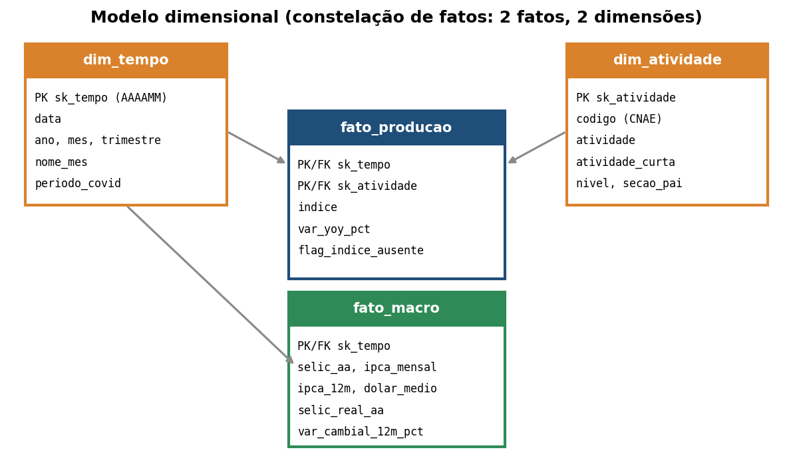

*Figura 1 — Modelo dimensional do MVP: constelação de fatos com dimensão tempo compartilhada (catalogo/diagrama_estrela.png).*


### 3.2 Catálogo de dados

Cada atributo tem dois domínios. O domínio esperado é declarado a priori, pelo significado do dado (por exemplo, número-índice estritamente positivo; variação percentual nunca abaixo de −100%; Selic entre 0 e 50% a.a.), e está codificado em scripts/dominios.py. O domínio observado é lido da base carregada. A análise de qualidade (Seção 5.1) confere, atributo a atributo, se o observado respeita o esperado. O catálogo completo, com descrição, obrigatoriedade e linhagem de cada atributo, está em catalogo/catalogo_dados.md e .csv.

| Tabela | Atributo | Tipo | Descrição | Domínio esperado | Domínio observado | Nulos | Linhagem |
|---|---|---|---|---|---|---|---|
| dim_tempo | sk_tempo | inteiro (chave) | Chave do mês no formato AAAAMM. | 200201 a 202612 | 200201 a 202609 | 0 | Gerada no ETL a partir do mês da fonte (R1). |
| dim_tempo | data | data | Primeiro dia do mês. | 2002-01-01 a 2026-12-01 | 2002-01-01 a 2026-09-01 | 0 | Mês em português da SIDRA / data dd/mm/aaaa do SGS -> 1º dia do mês (R1, R4). |
| dim_tempo | ano | inteiro | Ano civil. | 2002 a 2026 | 2002 a 2026 | 0 | Derivado de data. |
| dim_tempo | mes | inteiro | Mês civil (1–12). | 1 a 12 | 1 a 12 | 0 | Derivado de data. |
| dim_tempo | trimestre | inteiro | Trimestre civil (1–4). | 1 a 4 | 1 a 4 | 0 | Derivado de data. |
| dim_tempo | nome_mes | categórico | Abreviatura do mês gerada pelo locale do ambiente de execução (inglês: Jan…Dec). Usada só para rótulos. | 12 valores (Jan, Feb, Mar, …) | 12 categorias (ex.: Apr, Aug, Dec, Feb, …) | 0 | Derivado de data. |
| dim_tempo | periodo_covid | booleano (0/1) | 1 entre mar/2020 e dez/2020 (choque inicial da pandemia); a análise usa janela mais larga (mar/2020–jun/2021). | 0, 1 | 0 a 1 | 0 | Regra fixa do ETL. |
| dim_atividade | sk_atividade | inteiro (chave) | Chave substituta da atividade industrial. | 1 a 27 | 1 a 27 | 0 | Sequência gerada no ETL. |
| dim_atividade | codigo | categórico (texto) | Código CNAE 2.0 da seção/divisão (1 = geral; 2 = extrativas; 3 = transformação; 3.10–3.33 = divisões). | 27 valores (1, 2, 3, …) | 27 categorias (ex.: 1, 2, 3, 3.10, …) | 0 | Extraído do rótulo da atividade (R2). IBGE/SIDRA tabela 8888 (PIM-PF), variável 12606, coletada em 28/09/2026. |
| dim_atividade | atividade | texto | Nome oficial da atividade. | texto livre | texto livre (27 valores distintos) | 0 | Extraído do rótulo (R2). IBGE/SIDRA tabela 8888 (PIM-PF), variável 12606, coletada em 28/09/2026. |
| dim_atividade | atividade_curta | texto | Nome sem o prefixo 'Fabricação de', cortado em 42 caracteres. As tabelas e os gráficos do relatório usam um nome curto revisado à mão (scripts/dominios.py). | texto livre | texto livre (27 valores distintos) | 0 | Derivado de atividade. |
| dim_atividade | nivel | categórico | Nível hierárquico: geral, secao ou divisao. | geral, secao, divisao | divisao, geral, secao | 0 | Derivado do código. |
| dim_atividade | secao_pai | categórico | Seção à qual a divisão pertence ('3'). Nulo para geral e seções. | 3 | 3 | 3 | Derivado do código. |
| fato_producao | sk_tempo | inteiro (FK) | Mês da observação. | 200201 a 202612 | 200201 a 202607 | 0 | FK para dim_tempo. |
| fato_producao | sk_atividade | inteiro (FK) | Atividade da observação. | 1 a 27 | 1 a 27 | 0 | FK para dim_atividade. |
| fato_producao | indice | numérico | Número-índice de produção física (base 2022 = 100), sem ajuste sazonal. | 0,01 a 500 | 9.39 a 316.93 | 240 | IBGE/SIDRA tabela 8888 (PIM-PF), variável 12606, coletada em 28/09/2026. '-' convertido em NULL (R3). |
| fato_producao | var_yoy_pct | numérico (%) | Variação % do índice frente ao mesmo mês do ano anterior. | ≥ -100 | -92.11 a 938.77 | 564 | Calculada no ETL (R6). |
| fato_producao | flag_indice_ausente | booleano (0/1) | 1 quando o índice é nulo. | 0, 1 | 0 a 1 | 0 | Derivado de indice. |
| fato_macro | sk_tempo | inteiro (FK) | Mês da observação. | 200201 a 202612 | 200201 a 202609 | 0 | FK para dim_tempo. |
| fato_macro | selic_aa | numérico (% a.a.) | Taxa Selic acumulada no mês, anualizada (base 252). | 0 a 50 | 1.90 a 26.32 | 0 | BCB/SGS série 4189, coletada em 28/09/2026. |
| fato_macro | ipca_mensal | numérico (% a.m.) | Variação mensal do IPCA. | -2 a 5 | -0.68 a 3.02 | 1 | BCB/SGS série 433, coletada em 28/09/2026. |
| fato_macro | ipca_12m | numérico (%) | IPCA acumulado em 12 meses. | -5 a 30 | 1.88 a 17.24 | 1 | BCB/SGS série 13522, coletada em 28/09/2026. |
| fato_macro | dolar_medio | numérico (R$/US$) | Taxa de câmbio livre, dólar (venda), média do mês. | 1 a 10 | 1.56 a 6.10 | 1 | BCB/SGS série 3698, coletada em 28/09/2026. |
| fato_macro | selic_real_aa | numérico (% a.a.) | Juro real ex-post: (1+Selic)/(1+IPCA 12m) − 1. | -15 a 30 | -4.44 a 12.95 | 1 | Calculada no ETL (R7) a partir de selic_aa e ipca_12m. |
| fato_macro | var_cambial_12m_pct | numérico (%) | Variação % do dólar médio frente ao mesmo mês do ano anterior (positivo = real desvalorizado). | ≥ -100 | -26.90 a 67.45 | 13 | Calculada no ETL (R8). |
| fato_macro | flag_tem_producao | booleano (0/1) | 1 quando o mês também existe na PIM-PF (R9). | 0, 1 | 0 a 1 | 0 | Derivado no ETL. |
| mapa_risco | sk_atividade | inteiro (FK) | Divisão avaliada. | 4 a 27 | 4 a 27 | 0 | FK para dim_atividade. Gerada por scripts/analise.py (camada de consumo). |
| mapa_risco | codigo | categórico (texto) | Código CNAE da divisão. | 24 valores (3.10, 3.11, 3.12, …) | 24 categorias (ex.: 3.10, 3.11, 3.12, 3.13, …) | 0 | Copiado de dim_atividade. |
| mapa_risco | atividade | texto | Nome curto da divisão. | texto livre | texto livre (24 valores distintos) | 0 | scripts/dominios.py (NOMES_CURTOS). |
| mapa_risco | folga_pp | numérico (%) | Dimensão Folga: quanto a produção dos últimos 12 meses está abaixo da média de 2019 (negativo = acima). | -100 a 100 | -38.39 a 33.07 | 0 | fato_producao.indice; média 2019 vs. últimos 12 meses. |
| mapa_risco | instabilidade_pp | numérico (p.p.) | Dimensão Instabilidade: desvio-padrão do crescimento anual, 2013–2026, sem a pandemia. | ≥ 0 | 4.39 a 19.59 | 0 | fato_producao.var_yoy_pct. |
| mapa_risco | expos_juro_pp | numérico (p.p.) | Dimensão Exposição ao juro: quanto o crescimento anual médio é menor em ciclos de alta da Selic (Selic > 12 meses antes) do que em ciclos de corte, 2003–2026. | -50 a 50 | -4.91 a 12.88 | 0 | fato_producao.var_yoy_pct e fato_macro.selic_aa. |
| mapa_risco | expos_cambio_pp | numérico (p.p.) | Dimensão Exposição ao câmbio: menos o coeficiente da variação cambial de 12 meses na regressão com juro real (p.p. a menos por 1% de desvalorização). | -5 a 5 | 0.01 a 0.45 | 0 | fato_producao.var_yoy_pct e fato_macro.var_cambial_12m_pct; OLS com erros de Newey-West. |
| mapa_risco | indice_risco | numérico | Média simples dos escores padronizados (z) das quatro dimensões. | -5 a 5 | -0.93 a 1.70 | 0 | Calculado em scripts/analise.py. |
| mapa_risco | ranking | inteiro | Posição no índice (1 = maior risco). | 1 a 24 | 1 a 24 | 0 | Ordenação de indice_risco. |
| mapa_risco | faixa | categórico | Terço do ranking: alto (1–8), médio (9–16), baixo (17–24). | alto, médio, baixo | alto, baixo, médio | 0 | Derivado de ranking. |

Sobre a obrigatoriedade: os únicos nulos com significado próprio são (a) o índice das divisões 3.18 (Impressão) e 3.33 (Manutenção), que o IBGE só publica a partir de 2012, (b) os 12 primeiros meses de variação anual e cambial, que dependem de um ano de histórico, e (c) os campos do mês corrente do BCB (setembro/2026), ainda sem divulgação completa. Nenhum nulo foi imputado.


## 4. Carga (ETL)


### 4.1 Arquitetura do pipeline

O pipeline segue a arquitetura em camadas (medallion) e é executado por três notebooks Databricks, cada um um invólucro fino sobre um script Python versionado. O mesmo código roda localmente (SQLite) e na nuvem (tabelas Delta), o que permitiu validar a lógica antes de subir à plataforma.

| Camada | Conteúdo | Onde | Código |
|---|---|---|---|
| Bronze | JSON bruto das APIs, sem alteração | Volume raw (Unity Catalog) / data/raw | notebooks/01_coleta_bronze.py → scripts/coleta.py |
| Silver | Tabelas limpas e tipadas (datas, códigos, nulos) | Memória do ETL | scripts/etl.py (R1 a R6) |
| Gold | Esquema estrela em Delta | workspace.industria_juros.* | notebooks/02_etl_silver_gold.py → scripts/etl.py (R7 a R9) |
| Consumo | Consultas SQL, testes e gráficos | Notebook 03 | notebooks/03_analise.py → scripts/analise.py |


### 4.2 Regras de negócio da transformação

| Regra | Descrição | Efeito medido |
|---|---|---|
| R1 | Mês em português ("janeiro 2002") convertido em data (1º dia do mês) e chave AAAAMM. | 295 meses PIM-PF e 297 meses BCB alinhados. |
| R2 | Código CNAE separado do nome da atividade. | 27 atividades: 1 geral, 2 seções e 24 divisões. |
| R3 | "-" (sem informação) vira NULL; nunca imputado. | 240 valores nulos (2 divisões × 120 meses). |
| R4 | Datas do BCB (dd/mm/aaaa) normalizadas para o 1º dia do mês; valores em ponto flutuante. | Junção exata por mês. |
| R5 | Duplicatas pela chave natural (mês, atividade) removidas, mantendo a primeira. | 0 duplicatas. |
| R6 | Variação anual = índice ÷ índice de 12 meses antes − 1, por atividade. | 564 nulos estruturais (12 meses iniciais e ausências). |
| R7 | Juro real ex-post = (1 + Selic a.a.) ÷ (1 + IPCA 12m) − 1. | Faixa observada de −4,4% a 13,0% a.a. |
| R8 | Variação cambial 12m = dólar médio ÷ dólar médio de 12 meses antes − 1. | Positivo = real desvalorizado. |
| R9 | Meses só do BCB (sem PIM-PF) permanecem na fato_macro com flag_tem_producao = 0. | 2 meses (ago. e set./2026). |

Foram verificadas as integridades referencial (toda chave das fatos existe nas dimensões) e de unicidade (nenhuma duplicata na chave composta), com asserções no ETL: o script falha se alguma delas for violada.


### 4.3 Execução na nuvem e persistência

Execução realizada em 09/11/2026 no Databricks Free Edition (compute serverless), a partir de uma Git folder ligada ao repositório público do GitHub. Os três notebooks foram executados em ordem, do Volume vazio até a tabela de consumo, e as capturas de tela estão referenciadas abaixo. Uma primeira execução, em 28/09/2026, havia mostrado que o Free Edition não resolve o DNS das APIs do IBGE e do BCB; por isso o notebook 01 copia o bronze versionado.

Notebook 01 (bronze). Os seis arquivos brutos foram gravados no Volume workspace.industria_juros.raw (Figura 2). O JSON da PIM-PF tem 1.650.738 bytes, igual ao registrado no manifesto de coleta, que aparece abaixo da listagem com URL, data e hash de cada arquivo.

Notebook 02 (silver e gold). O ETL rodou dentro do Databricks e gravou as quatro tabelas Delta em workspace.industria_juros. As contagens de linhas são idênticas às da execução local: dim_tempo 297, dim_atividade 27, fato_producao 7.965 e fato_macro 297 (Figura 3). O DESCRIBE HISTORY da fato_producao mostra a versão 0 criada por CREATE OR REPLACE TABLE AS SELECT em 09/11/2026, pelo usuário da conta, o que comprova a persistência (Figura 4).

Notebook 03 (análise). As consultas SQL sobre as tabelas Delta reproduzem os resultados locais. A completude do índice (Figura 5) mostra 120 meses ausentes em 3.18 e 3.33. A dimensão Folga (Figura 6) dá −33,1% para Impressão e −27,0% para Vestuário. A dimensão Instabilidade (Figura 7) dá desvios de 19,6, 17,0, 16,9 e 16,7 p.p. para Fumo, Informática, Veículos e Impressão. A exposição ao juro por ciclos, calculada em SQL com LAG sobre a Selic (Figura 8), dá −12,9 p.p. para Veículos, −12,1 para Informática e −9,3 para Móveis, os mesmos valores da execução local.

Em seguida, scripts/analise.py rodou sobre as tabelas Delta e reproduziu, com a mesma semente, o teste de ciclos (Figura 9: no período completo, 21 de 24 divisões crescem menos na alta da Selic, 6 com significância, e a indústria geral cresce 3,48 p.p. a menos, p = 0,040). O notebook gravou o mapa de risco como tabela Delta workspace.industria_juros.mapa_risco (Figura 10), com o mesmo ranking da execução local: Informática e eletrônicos, Veículos e Impressão nas três primeiras posições.

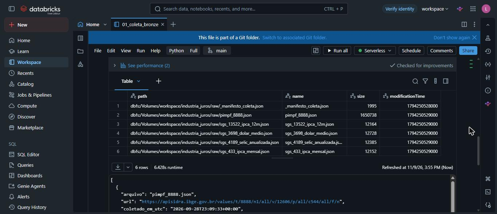

*Figura 2 — Notebook 01: arquivos brutos no Volume workspace.industria_juros.raw e início do manifesto de coleta.*

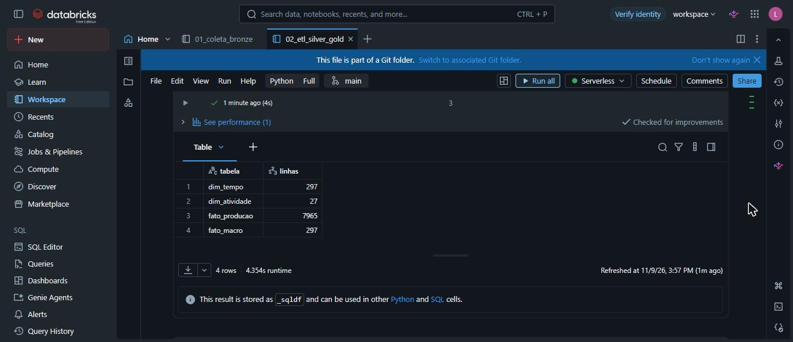

*Figura 3 — Notebook 02: contagem das quatro tabelas Delta após a carga.*

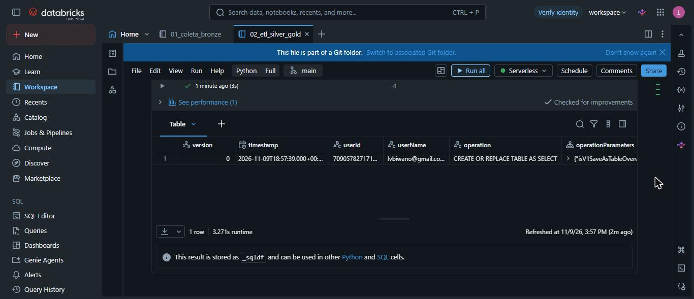

*Figura 4 — Notebook 02: DESCRIBE HISTORY da fato_producao (persistência Delta).*

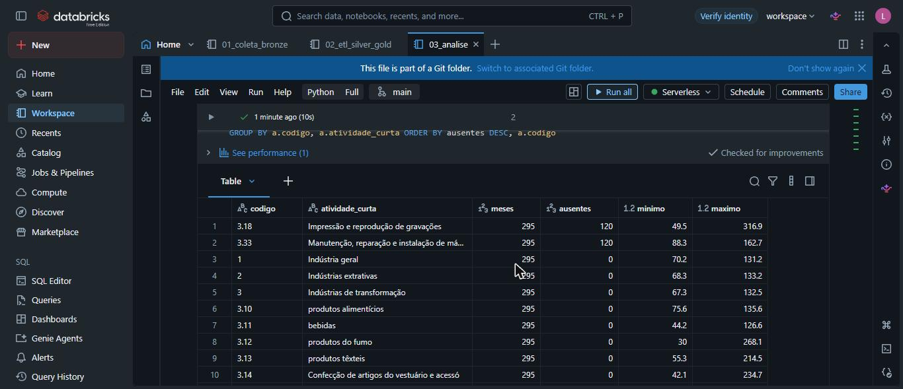

*Figura 5 — Notebook 03: qualidade do índice por atividade, em SQL sobre o Delta.*

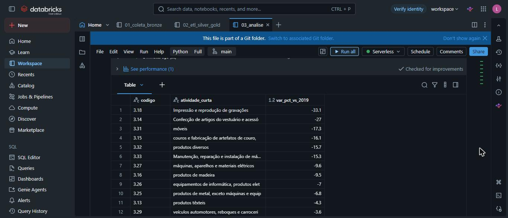

*Figura 6 — Notebook 03: dimensão Folga em SQL (variação vs. média de 2019).*

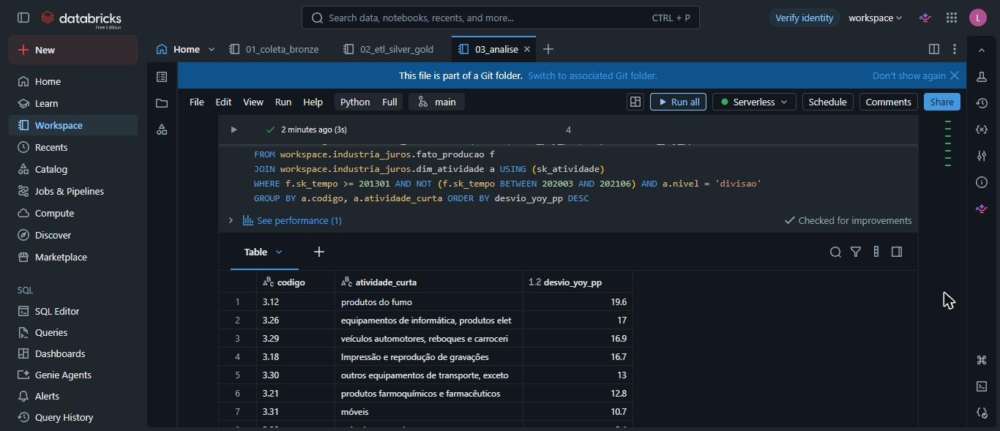

*Figura 7 — Notebook 03: dimensão Instabilidade em SQL (desvio-padrão do crescimento anual).*

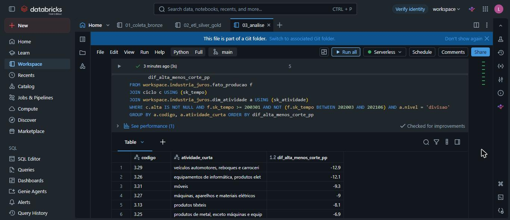

*Figura 8 — Notebook 03: exposição ao juro por ciclos da Selic, em SQL sobre o Delta.*

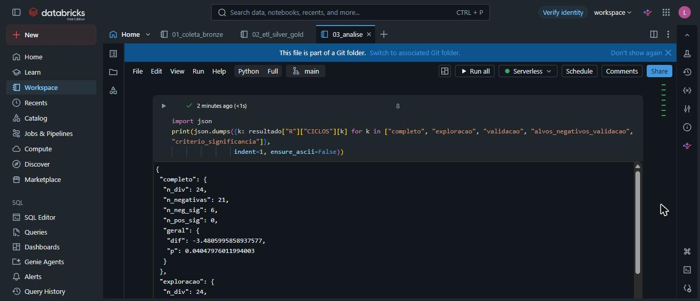

*Figura 9 — Notebook 03: resumo do teste de ciclos calculado por scripts/analise.py sobre o Delta.*

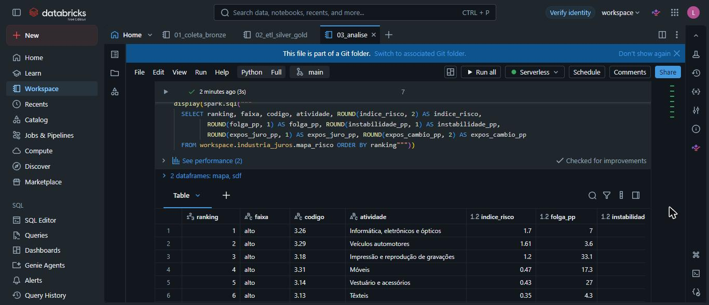

*Figura 10 — Notebook 03: tabela de consumo mapa_risco gravada em Delta, ordenada pelo ranking.*


### 4.4 Uso de recursos e custo de operação

O enunciado pede evidência de viabilidade financeira: uso de recursos compatível com o problema e custo de operação estimado. O volume é pequeno: 1,7 MB de JSON bruto e 8.586 linhas nas quatro tabelas Delta. Uma execução completa (três notebooks) roda em compute serverless de menor porte, sem cluster dedicado.

| Item | Neste MVP | Operação contínua (estimativa) |
|---|---|---|
| Plataforma | Databricks Free Edition | Workspace pago (Premium), job serverless |
| Computação | R$ 0 (cota gratuita) | Ordem de 1 DBU por execução × US$ 0,35/DBU (preço de lista de Jobs Serverless, AWS Premium, conferido em nov/2026) ≈ US$ 0,35 por mês, com uma execução mensal |
| Armazenamento | R$ 0 | 1,7 MB brutos + tabelas Delta: custo de armazenamento desprezível (centavos por mês) |
| Coleta | APIs públicas, sem chave e sem custo | Idem |

O consumo de DBU não foi medido: o Free Edition não expõe esse número, e a linha de 1 DBU por execução é uma ordem de grandeza para três notebooks curtos sobre menos de 2 MB, não uma medição. Mesmo multiplicada por dez, a operação mensal fica abaixo de US$ 5. Conclusão: o custo não é obstáculo. A restrição real observada foi técnica: o Free Edition não acessa a internet, o que obrigou a separar a coleta (local) da persistência (nuvem), como descrito na Seção 4.3.


## 5. Análise


### 5.1 Qualidade dos dados

A qualidade foi verificada em dois níveis. Primeiro, atributo a atributo: para cada um dos 26 atributos das quatro tabelas, mediram-se completude, número de valores distintos e aderência ao domínio esperado declarado no catálogo (Seção 3.2). Depois, nas seis dimensões usuais, com testes que cruzam atributos e fontes. Todos os números vêm do script de análise (data/processed/resultados.json e tab_qualidade_atributos.csv).

| Tabela | Atributo | Completude | Nulos | Distintos | Fora do domínio esperado |
|---|---|---|---|---|---|
| dim_tempo | sk_tempo | 100,0% | 0 | 297 | 0 |
| dim_tempo | data | 100,0% | 0 | 297 | 0 |
| dim_tempo | ano | 100,0% | 0 | 25 | 0 |
| dim_tempo | mes | 100,0% | 0 | 12 | 0 |
| dim_tempo | trimestre | 100,0% | 0 | 4 | 0 |
| dim_tempo | nome_mes | 100,0% | 0 | 12 | 0 |
| dim_tempo | periodo_covid | 100,0% | 0 | 2 | 0 |
| dim_atividade | sk_atividade | 100,0% | 0 | 27 | 0 |
| dim_atividade | codigo | 100,0% | 0 | 27 | 0 |
| dim_atividade | atividade | 100,0% | 0 | 27 | 0 |
| dim_atividade | atividade_curta | 100,0% | 0 | 27 | 0 |
| dim_atividade | nivel | 100,0% | 0 | 3 | 0 |
| dim_atividade | secao_pai | 88,9% | 3 | 1 | 0 |
| fato_producao | sk_tempo | 100,0% | 0 | 295 | 0 |
| fato_producao | sk_atividade | 100,0% | 0 | 27 | 0 |
| fato_producao | indice | 97,0% | 240 | 7.723 | 0 |
| fato_producao | var_yoy_pct | 92,9% | 564 | 7.401 | 0 |
| fato_producao | flag_indice_ausente | 100,0% | 0 | 2 | 0 |
| fato_macro | sk_tempo | 100,0% | 0 | 297 | 0 |
| fato_macro | selic_aa | 100,0% | 0 | 198 | 0 |
| fato_macro | ipca_mensal | 99,7% | 1 | 123 | 0 |
| fato_macro | ipca_12m | 99,7% | 1 | 240 | 0 |
| fato_macro | dolar_medio | 99,7% | 1 | 294 | 0 |
| fato_macro | selic_real_aa | 99,7% | 1 | 295 | 0 |
| fato_macro | var_cambial_12m_pct | 95,6% | 13 | 284 | 0 |
| fato_macro | flag_tem_producao | 100,0% | 0 | 2 | 0 |

Resultado atributo a atributo: 0 dos 26 atributos têm valores fora do domínio esperado, e 8 têm nulos, todos explicados na Seção 3.2 (séries que o IBGE só publica a partir de 2012, variações que dependem de 12 meses de histórico e o mês corrente do BCB). As chaves primárias das quatro tabelas não têm duplicatas (0 no total) e não há chave estrangeira órfã (0 no total). O índice tem 7.723 valores distintos em 7.965 linhas e a Selic, 198 em 297 meses; repetições são esperadas em séries arredondadas a duas casas e não indicam duplicação, já descartada pelo teste de chave.

| Dimensão | Verificação | Resultado | Tratamento |
|---|---|---|---|
| Completude | Nulos por atributo | Índice: 240 nulos, todos nas divisões 3.18 e 3.33 entre jan/2002 e dez/2011. IPCA e dólar: 1 nulo cada (set./2026). | Não imputados. As séries são usadas só a partir de 2013, período em que todas as 27 estão completas. |
| Unicidade | Duplicatas em (mês, atividade) | 0 duplicatas; 0 lacunas de mês em qualquer série. | Nenhum. |
| Consistência | Variação anual recalculada; IPCA 12m oficial vs. composição do IPCA mensal; indústria geral vs. seções | Diferença máxima da variação anual: 1e-14 p.p.; IPCA 12m: diferença média de 0,0025 p.p. (máxima 0,009 p.p., arredondamento); a indústria geral fica entre as seções em 100% dos meses. | Nenhum. Fontes coerentes entre si. |
| Conformidade | Aderência ao domínio esperado do catálogo | 0 atributos fora do domínio (tabela acima). Índice > 0 em 100% das linhas (mín. 9,4; máx. 316,9). Selic 1,9–26,3% a.a.; dólar R$ 1,56–6,10. | Nenhum. Todos plausíveis. |
| Acurácia | Outliers da variação anual (z robusto, em módulo, acima de 5) | 58 pontos, dos quais 48 em mar/2020–jun/2021 (choque e rebote: maior valor, veículos em abr/2021, +939% sobre a base do lockdown) e 10 fora dele. | A janela de pandemia é excluída das estatísticas (P2 a P4); os 10 pontos restantes são mantidos (variações reais de setores voláteis). |
| Atualidade | Defasagem entre fontes | PIM-PF vai até jul/2026; o BCB, até 2026/09 (defasagem de 2 meses). O último mês do BCB é parcial. | Junção por interseção (R9); o cenário de corte de juros (P3) usa o último juro real completo (ago./2026). |

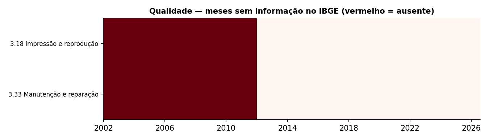

*Figura 11 — Meses sem informação no IBGE: apenas as divisões 3.18 e 3.33, antes de 2012.*

Ressalva importante: o índice não tem ajuste sazonal. A série industrial oscila fortemente entre meses por sazonalidade (Figura 12), o que torna inadequada a comparação mês a mês. Por isso toda a análise usa variação contra o mesmo mês do ano anterior, que elimina a sazonalidade, e médias de 12 meses.

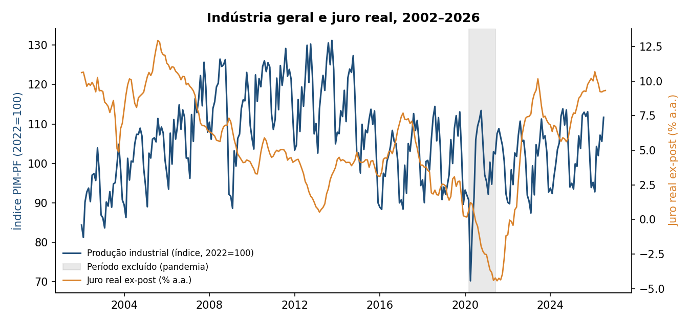

*Figura 12 — Produção industrial (índice sem ajuste sazonal) e juro real ex-post, 2002–2026.*

Amostra de análise. Para instabilidade (P2), nível do juro (P3) e câmbio (P4) usa-se janeiro/2013 a julho/2026, excluindo mar/2020–jun/2021: 147 meses, comum às 27 atividades. O corte em 2013 é o primeiro mês em que as duas divisões de série curta têm variação anual; a exclusão da pandemia evita que um único choque de +900% domine correlações e regressões. A análise de ciclos de juros (P3) usa também 2003–2012, para a validação fora da amostra, com as 22 divisões que já eram publicadas.


### 5.2 P1 — Folga: recuperação em relação a 2019

O agregado voltou: a indústria geral produz hoje (média dos últimos 12 meses) 3,0% acima da média de 2019, com queda máxima de 31% no fundo de 2020 e retorno sustentado ao patamar de 2019 em 4 meses. As extrativas estão 10,3% acima, e a indústria de transformação, 1,5% acima. A média, porém, esconde a divisão: das 24 divisões da transformação, 13 ainda estão abaixo de 2019 e 11 acima (Figura 13).

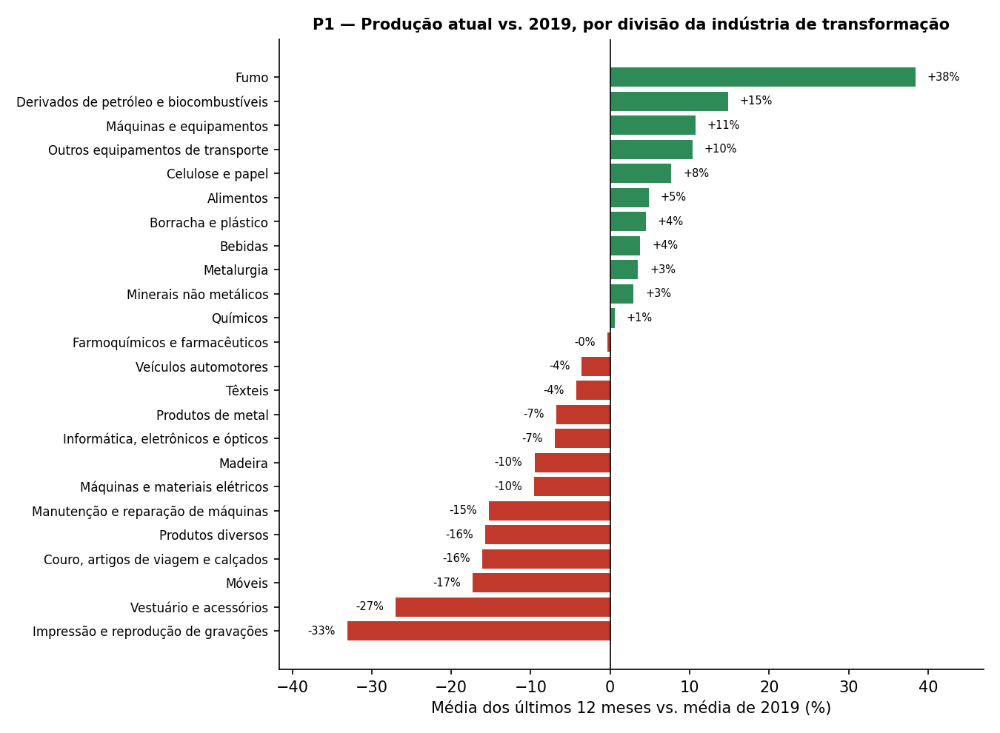

*Figura 13 — Folga: produção dos últimos 12 meses vs. média de 2019, por divisão (P1).*

| Cód. | Divisão | Atual vs. 2019 | Queda máx. 2020 | Meses p/ recuperar |
|---|---|---|---|---|
| 3.18 | Impressão e reprodução de gravações | -33,1% | -66% | não recuperou |
| 3.14 | Vestuário e acessórios | -27,0% | -67% | não recuperou |
| 3.31 | Móveis | -17,3% | -61% | 4 |
| 3.15 | Couro, artigos de viagem e calçados | -16,1% | -70% | 6 |
| 3.32 | Produtos diversos | -15,7% | -49% | não recuperou |
| 3.17 | Celulose e papel | +7,7% | -6% | 4 |
| 3.30 | Outros equipamentos de transporte | +10,3% | -81% | 29 |
| 3.28 | Máquinas e equipamentos | +10,7% | -41% | 5 |
| 3.19 | Derivados de petróleo e biocombustíveis | +14,8% | -16% | 2 |
| 3.12 | Fumo | +38,4% | 2% | 0 |

Resposta a P1. As divisões com mais folga são Impressão (−33%), Vestuário (−27%), Móveis (−17%), Couro e calçados (−16%) e Produtos diversos (−16%): atividades intensivas em mão de obra e ligadas ao consumo das famílias e à mídia física. Quatro divisões (Impressão, Vestuário, Produtos diversos e Manutenção) nunca tiveram três meses seguidos acima da média de 2019 desde o choque. No outro extremo estão Fumo (+38%), Derivados de petróleo (+15%), Máquinas e equipamentos (+11%) e Outros equipamentos de transporte (+10%). H4 confirmada: a recuperação foi desigual, e o agregado (+3,0%) esconde 13 divisões abaixo do nível pré-pandemia. Cautela: 2019 foi um ano de crescimento fraco, então "acima de 2019" não significa "acima da tendência".


### 5.3 P2 — Instabilidade

A instabilidade é o desvio-padrão do crescimento anual na amostra de análise (2013–2026, sem a pandemia). As divisões variam mais de quatro vezes entre si: Fumo (19,6 p.p.), Informática (17,0), Veículos (16,9) e Impressão (16,7) são as mais instáveis; Celulose e papel (4,4), Químicos (4,7) e Minerais não metálicos (5,6) as mais estáveis. A indústria geral, por diversificação, tem 4,5 p.p., no nível da divisão mais estável.

Resposta a P2. A razão entre a divisão mais e a menos instável é de 4,5 vezes. O pior crescimento anual de Veículos é −39% sem a pandemia e −92% com ela; o de Celulose e papel é −11% nos dois casos. É a dimensão mais estável e diretamente mensurável do mapa.


### 5.4 P3 — Exposição ao juro

A exposição ao juro foi medida de dois modos. O primeiro olha o nível do juro real; o segundo, a direção da Selic.

Nível do juro real. Para cada uma das 27 atividades calculou-se a correlação entre o crescimento anual em t e o juro real em t−k, para k de 0 a 12 meses (Figura 14). Como a escolha do melhor k dentre 13 defasagens infla a chance de achar correlação por acaso, e as séries são autocorrelacionadas, a significância foi avaliada por um teste de permutação: o juro real é deslocado circularmente (2.000 deslocamentos) e compara-se a correlação mais negativa observada com a distribuição do mínimo sobre as 13 defasagens. Resultado: 0 das 27 séries têm p < 0,05; só 11 correlações têm o sinal esperado, e a indústria geral tem correlação positiva (+0,19). O cenário de queda de 3 p.p. no juro real, aplicado aos coeficientes de uma regressão com erros de Newey-West, projeta -0,31 p.p. para a indústria geral (IC 95%: -1,3 a +0,7), indistinguível de zero. O nível do juro real não diferencia as divisões.

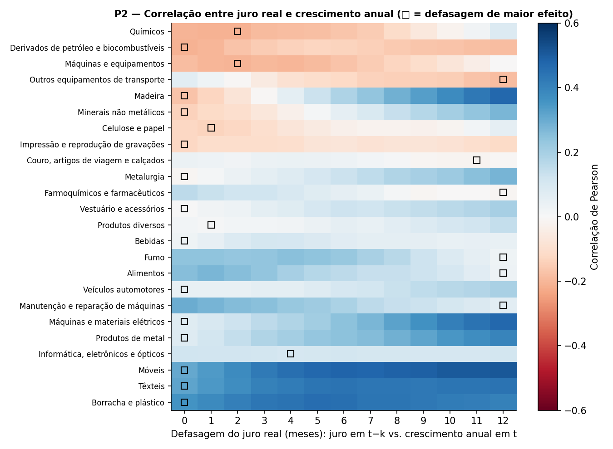

*Figura 14 — Nível do juro: correlação entre juro real defasado e crescimento anual, por divisão (P3).*

Direção da Selic. Um mês é de ciclo de alta quando a Selic está acima da de 12 meses antes. De 2003 a 2026 houve sete ciclos de alta (129 dos 267 meses analisados, sem a pandemia). Para cada divisão, compara-se o crescimento anual médio nos meses de alta com o dos meses de corte, com a mesma permutação circular para a significância. A hipótese surgiu na exploração de 2013–2026; por isso foi testada em 2003–2012, período sem nenhum mês em comum, com o critério declarado antes: confirmar-se-ia se ao menos 4 das 6 divisões significativas na exploração mantivessem sinal negativo e se o número de divisões com efeito negativo significativo superasse o esperado por acaso.

| Período | Divisões | Crescem menos na alta | Negativas significativas | Positivas significativas | Indústria geral (p.p.) |
|---|---|---|---|---|---|
| 2013–2026 (exploração) | 24 | 21 | 7 | 0 | -3,7 |
| 2003–2012 (validação) | 22 | 18 | 1 | 0 | -2,5 |
| 2003–2026 (completo) | 24 | 21 | 6 | 0 | -3,5 |

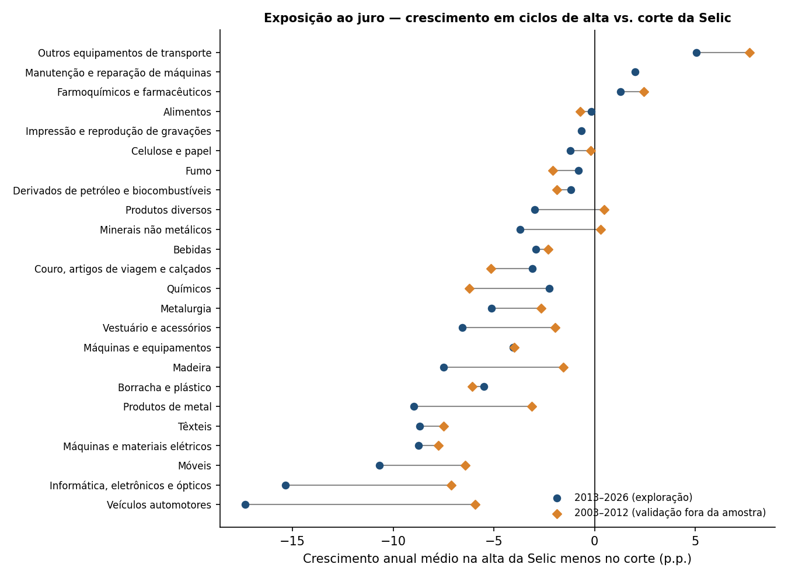

*Figura 15 — Direção da Selic: crescimento anual na alta menos no corte, nos dois períodos independentes (P3).*

| Divisão (significativa na exploração) | 2013–2026 (p.p.) | 2003–2012 (p.p.) | p em 2003–2012 |
|---|---|---|---|
| Móveis | -10,7 | -6,4 | 0,130 |
| Têxteis | -8,7 | -7,5 | 0,092 |
| Bebidas | -2,9 | -2,3 | 0,437 |
| Produtos de metal | -9,0 | -3,1 | 0,577 |
| Madeira | -7,5 | -1,6 | 0,785 |
| Máquinas e materiais elétricos | -8,8 | -7,8 | 0,048 |

Resposta a P3. O nível do juro real não explica o crescimento de nenhuma divisão. A direção da Selic explica parte: em ciclos de alta, 21 das 24 divisões crescem menos, e a indústria geral cresce 3,5 p.p. a menos (p = 0,04). Na validação fora da amostra, as 6 divisões da exploração mantiveram o sinal negativo, e 18 de 22 apontaram na mesma direção. Mas só 1 delas (Máquinas e materiais elétricos) foi significativa sozinha. Pelo critério declarado, o sinal se confirmou e a significância setorial não. H2 é parcialmente sustentada: a direção é consistente em dois períodos independentes, e os setores de duráveis e construção estão entre os mais afetados, mas o efeito de cada divisão isolada não se distingue do ruído com tão poucos ciclos. Para o mapa, a exposição ao juro de cada divisão é a diferença no período completo (2003–2026), que usa os sete ciclos.


### 5.5 P4 — Exposição ao câmbio

Para cada atividade estimou-se por mínimos quadrados o crescimento anual contra o juro real defasado e a variação cambial de 12 meses, com erros-padrão robustos a autocorrelação e heterocedasticidade (Newey-West, 12 defasagens). A Figura 16 mostra os coeficientes com intervalos de 95%.

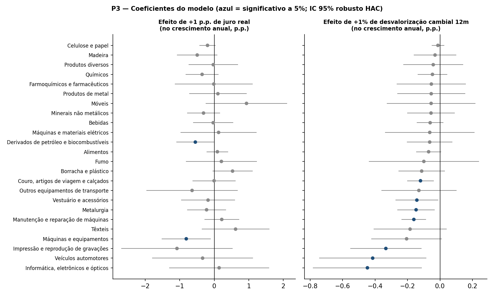

*Figura 16 — Exposição ao câmbio: coeficientes do juro real e da variação cambial por divisão (P4).*

| Atividade | β câmbio (p.p. por 1% de desvalorização) | estatística t |
|---|---|---|
| 3.33 Manutenção e reparação de máquinas | -0,16 | -4,18 |
| 3.18 Impressão e reprodução de gravações | -0,33 | -2,98 |
| 3.15 Couro, artigos de viagem e calçados | -0,12 | -2,86 |
| 3.26 Informática, eletrônicos e ópticos | -0,45 | -2,61 |
| 3.24 Metalurgia | -0,15 | -2,50 |
| 3.29 Veículos automotores | -0,41 | -2,47 |
| 1 Indústria geral | -0,12 | -2,42 |

Resposta a P4. O câmbio tem associação significativa em 9 das 27 atividades, e em todas o sinal é negativo: desvalorização do real acompanha crescimento menor. Para a indústria geral, cada 1% de desvalorização em 12 meses corresponde a 0,12 p.p. a menos de crescimento (t = -2,4). Os maiores efeitos estão em Informática e eletrônicos, Veículos e Impressão, que dependem de componentes importados. Nenhuma divisão tem efeito positivo significativo: H3 não se confirma. O poder explicativo é baixo (R² mediano 0,06), e as desvalorizações de 2015 e 2020 coincidiram com recessões, o que pode atribuir ao câmbio parte do efeito do ciclo.


### 5.6 P5 — Síntese: mapa de risco setorial

Cada dimensão foi transformada em escore padronizado (z) entre as 24 divisões, com sinal tal que valor maior significa mais risco: folga (quanto abaixo de 2019), instabilidade (desvio-padrão), exposição ao juro (quanto cresce a menos na alta da Selic) e exposição ao câmbio (quanto cresce a menos por 1% de desvalorização). O índice é a média simples dos quatro escores, o critério mais transparente na ausência de uma razão para pesar uma fonte de risco acima da outra. As divisões são divididas em três faixas de oito.

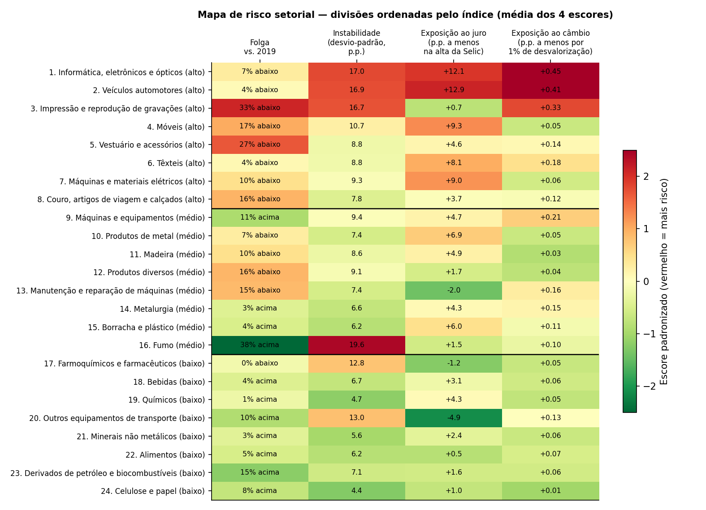

*Figura 17 — Mapa de risco setorial: cor = escore padronizado de cada dimensão; texto = valor na unidade original (P5).*

| # | Divisão | Faixa | Índice | Folga | Instab. | Juro | Câmbio |
|---|---|---|---|---|---|---|---|
| 1 | Informática, eletrônicos e ópticos | alto | 1,70 | 7% abaixo | 17,0 | 12,1 | 0,45 |
| 2 | Veículos automotores | alto | 1,61 | 4% abaixo | 16,9 | 12,9 | 0,41 |
| 3 | Impressão e reprodução de gravações | alto | 1,20 | 33% abaixo | 16,7 | 0,7 | 0,33 |
| 4 | Móveis | alto | 0,47 | 17% abaixo | 10,7 | 9,3 | 0,06 |
| 5 | Vestuário e acessórios | alto | 0,43 | 27% abaixo | 8,8 | 4,6 | 0,14 |
| 6 | Têxteis | alto | 0,35 | 4% abaixo | 8,8 | 8,1 | 0,18 |
| 7 | Máquinas e materiais elétricos | alto | 0,26 | 10% abaixo | 9,3 | 9,0 | 0,06 |
| 8 | Couro, artigos de viagem e calçados | alto | 0,09 | 16% abaixo | 7,8 | 3,7 | 0,12 |
| 9 | Máquinas e equipamentos | médio | -0,03 | 11% acima | 9,4 | 4,7 | 0,21 |
| 10 | Produtos de metal | médio | -0,05 | 7% abaixo | 7,4 | 6,9 | 0,05 |
| 11 | Madeira | médio | -0,10 | 10% abaixo | 8,6 | 4,9 | 0,03 |
| 12 | Produtos diversos | médio | -0,13 | 16% abaixo | 9,1 | 1,7 | 0,04 |
| 13 | Manutenção e reparação de máquinas | médio | -0,20 | 15% abaixo | 7,4 | -2,0 | 0,16 |
| 14 | Metalurgia | médio | -0,23 | 3% acima | 6,6 | 4,3 | 0,15 |
| 15 | Borracha e plástico | médio | -0,25 | 4% acima | 6,2 | 6,0 | 0,11 |
| 16 | Fumo | médio | -0,31 | 38% acima | 19,6 | 1,5 | 0,10 |
| 17 | Farmoquímicos e farmacêuticos | baixo | -0,32 | 0% abaixo | 12,8 | -1,2 | 0,05 |
| 18 | Bebidas | baixo | -0,49 | 4% acima | 6,7 | 3,1 | 0,06 |
| 19 | Químicos | baixo | -0,51 | 1% acima | 4,7 | 4,3 | 0,05 |
| 20 | Outros equipamentos de transporte | baixo | -0,54 | 10% acima | 13,0 | -4,9 | 0,13 |
| 21 | Minerais não metálicos | baixo | -0,60 | 3% acima | 5,6 | 2,4 | 0,06 |
| 22 | Alimentos | baixo | -0,67 | 5% acima | 6,2 | 0,5 | 0,07 |
| 23 | Derivados de petróleo e biocombustíveis | baixo | -0,74 | 15% acima | 7,1 | 1,6 | 0,06 |
| 24 | Celulose e papel | baixo | -0,93 | 8% acima | 4,4 | 1,0 | 0,01 |

Robustez. O ranking muda pouco com o critério. Usando a média das posições em vez da média dos escores, a correlação de postos com o índice é 0,99. Retirando uma dimensão de cada vez, a correlação fica entre 0,85 e 0,96, e das oito divisões de risco alto continuam no topo entre 6 e 8. As dimensões medem coisas distintas: a maior correlação entre elas é 0,65 (instabilidade e câmbio), e a folga é quase independente das demais.

Resposta a P5. As oito divisões de risco alto são Informática e eletrônicos, Veículos, Impressão, Móveis, Vestuário, Têxteis, Máquinas e materiais elétricos e Couro e calçados; as de risco baixo, Celulose e papel, Derivados de petróleo, Alimentos, Minerais não metálicos, Outros equipamentos de transporte, Químicos, Bebidas e Farmacêuticos. O mapa mostra também de onde vem o risco: em Informática e Veículos domina o câmbio, somado a alta instabilidade e exposição ao juro; em Impressão, Vestuário e Couro, a folga; em Móveis, Têxteis e Máquinas elétricas, a exposição ao juro. As três primeiras acumulam três das quatro fontes de risco: H1 confirmada. O caso de Fumo mostra por que combinar dimensões importa: é a divisão mais instável, mas está 38% acima de 2019 e pouco exposta a juro e câmbio, e fica em 16º.

Discussão geral. Para a área de crédito, o mapa traduz-se em três regras de uso. (1) A faixa define o ponto de partida do limite e da provisão. (2) A dimensão dominante indica o gatilho a monitorar: início de ciclo de alta da Selic para Móveis, Têxteis, Máquinas elétricas, Veículos e Informática; desvalorização cambial para Informática, Veículos e Impressão; recuperação da demanda para Impressão, Vestuário e Couro. (3) O nível do juro real não deve ser usado como gatilho: ele não diferencia as divisões. As limitações estão na Autoavaliação; a principal é que a exposição ao juro de cada divisão isolada é estimada com pouca precisão, o que o índice atenua ao combiná-la com três outras fontes.


## 6. Ética, licenciamento e proteção de dados

- Licença dos dados do Banco Central (SGS). As séries 4189, 433, 13522 e 3698 estão publicadas no Portal de Dados Abertos do BCB (dadosabertos.bcb.gov.br) sob a Open Data Commons Open Database License (ODbL). A ODbL permite redistribuir e criar bases derivadas, com duas condições: atribuição da fonte e compartilhamento da base derivada sob a mesma licença. Por isso as tabelas derivadas publicadas em data/processed (os CSV de fatos, dimensões e resultados, como fato_macro.csv e tab_mapa_risco.csv) são distribuídas também sob a ODbL, com atribuição ao BCB (registro no arquivo LICENSE).
- Licença dos dados do IBGE (SIDRA, tabela 8888). A PIM-PF é estatística oficial de divulgação pública. A reprodução é aceita com citação obrigatória da fonte, e o trabalho cita "IBGE, Pesquisa Industrial Mensal – Produção Física, tabela 8888 (SIDRA)" no README, no catálogo e no relatório. Não foi localizada uma licença aberta formal (do tipo CC ou ODbL) específica para a tabela, e isso fica registrado aqui. Para reutilização comercial, convém confirmar os termos diretamente com o IBGE.
- Versionamento dos dados brutos. Como as duas fontes permitem redistribuição com atribuição, e os arquivos são pequenos (cerca de 1,7 MB), os JSON brutos foram versionados em data/raw para garantir reprodutibilidade, inclusive no Databricks Free Edition, que não acessa a internet. O script de coleta também está publicado, e o manifesto registra URL, data e hash SHA-256 de cada arquivo.
- Dados pessoais (LGPD). Não se aplica: as bases são agregados nacionais mensais, sem identificadores de pessoas ou empresas.
- Dados corporativos. Não se aplica: nenhum dado de empresa foi utilizado.
- Coleta automatizada. Foram usadas apenas APIs oficiais, sem scraping, com pausa entre tentativas.
- Código. O código do repositório está sob a licença MIT (arquivo LICENSE).


## 7. Autoavaliação

Objetivos atingidos. A pergunta central foi respondida: o mapa de risco classifica as 24 divisões, mostra a fonte dominante de risco de cada uma e é estável a mudanças de critério. P1, P2 e P4 foram respondidas de forma conclusiva. P3 teve resposta mista: o nível do juro real não explica a produção setorial, e a direção da Selic tem efeito de sinal consistente em dois períodos independentes, mas sem significância setor a setor. Nenhuma pergunta da primeira versão foi removida; todas viraram dimensões do mapa (Seção 1.4).

Perguntas sugeridas:

- Quais perguntas foram respondidas e quais não? P1, P2, P4 e P5 foram respondidas. P3 foi respondida no agregado (ciclos de alta reduzem o crescimento de quase todas as divisões), mas não no detalhe: com sete ciclos de alta em 24 anos, o efeito de cada divisão isolada é estimado com pouca precisão. A versão anterior do trabalho, centrada no nível do juro, teve resposta nula; isso motivou a segunda volta do ciclo do MVP.
- Que limitações dos dados condicionaram os resultados? Índice sem ajuste sazonal (obrigou o uso de variação anual); poucos ciclos de juros; exclusão da pandemia; ausência de controles de crédito, renda e demanda externa; e o fato de os ciclos de alta de 2008 e de 2015 coincidirem com recessões, o que mistura o efeito do juro com o do ciclo econômico. No mapa, os pesos iguais são uma escolha: a análise de sensibilidade mostra que o ranking muda pouco, mas não elimina a escolha.
- Que decisões técnicas tomaria de outra forma? Começaria pela pergunta de decisão (o mapa de risco) em vez de cinco perguntas independentes, o que teria evitado uma primeira versão sem tese. Testaria o pipeline no Databricks desde o primeiro dia: só na execução real apareceu que o Free Edition não acessa a internet. E declararia as definições dos testes, como a de ciclo de alta, antes de olhar qualquer resultado, como foi feito na validação fora da amostra.
- Que extensões transformariam o MVP em solução de uso contínuo? Agendamento mensal do job (Databricks Workflows) alinhado à divulgação da PIM-PF, com carga incremental; o mapa de risco republicado a cada mês como tabela Delta e painel; testes automáticos de qualidade (as verificações da Seção 5.1 como expectativas de dados); inclusão de indicadores de crédito por setor e da PIM regional; e acompanhamento da estabilidade do ranking ao longo do tempo.

Trabalhos futuros. Identificar o efeito do juro com choques monetários (VAR estrutural ou surpresas de alta frequência), para separá-lo do ciclo econômico; validar o mapa contra inadimplência observada por setor (dados de crédito do BCB), o que permitiria calibrar os pesos em vez de fixá-los iguais; e estender o mapa a serviços e comércio.


## 8. Reprodutibilidade

- Local: python scripts/coleta.py → python scripts/etl.py → python scripts/analise.py → python scripts/gerar_catalogo.py → python scripts/gerar_relatorio.py. Dependências em requirements.txt. Semente aleatória fixa (42). O mapa de risco sai em data/processed/tab_mapa_risco.csv e na tabela mapa_risco do DW.
- Databricks: criar uma Git folder com o repositório e executar notebooks/01, 02 e 03 em ordem. Os notebooks usam catalog workspace e schema industria_juros. O notebook 01 parte, por padrão, do bronze versionado em data/raw (o Free Edition não acessa a internet, e isso mantém os números reprodutíveis); para coletar de novo das APIs, use COLETAR_DAS_APIS = True.
- Repositório: https://github.com/iwanolucas/MVP-Industria-Juros
- Fontes: IBGE/SIDRA tabela 8888 (PIM-PF); BCB/SGS séries 4189, 433, 13522 e 3698.
